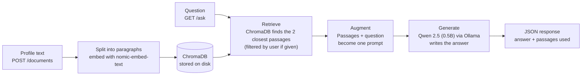
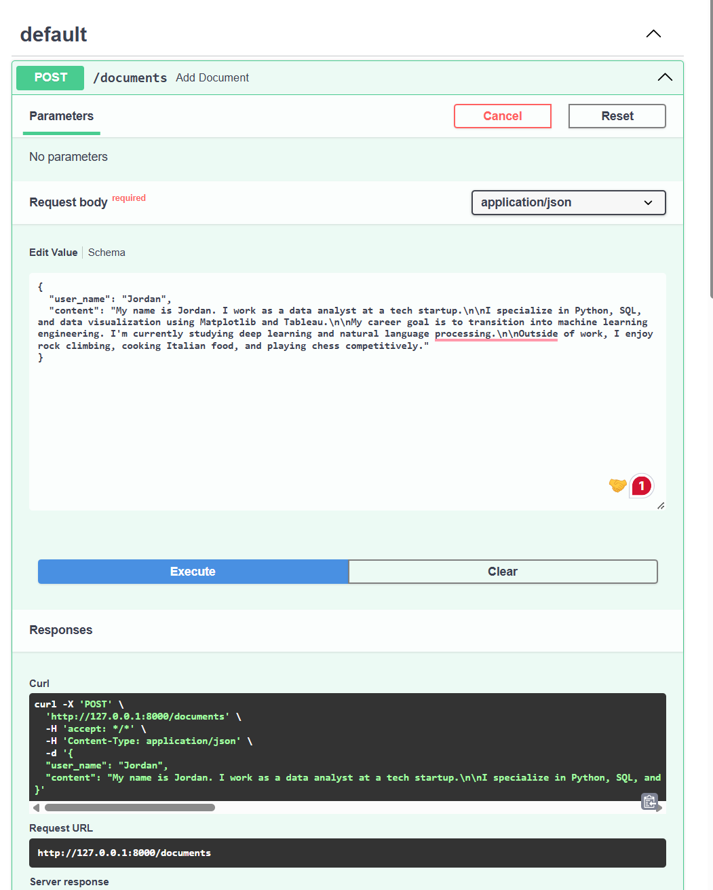
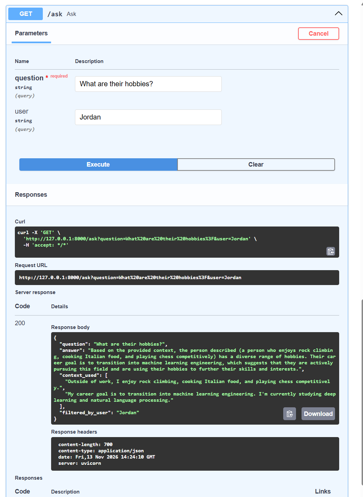

# RAG API with FastAPI

A small question-answering API that runs entirely on a laptop. You store short profiles of people, then ask questions about them in plain English. The API finds the most relevant passages and has a local AI model answer from them. No cloud AI service and no API keys are involved.

Built as part of NextWork's *Build a RAG API with FastAPI* project, including the optional multi-user extension.

## What it does

| Endpoint | What it does |
|---|---|
| `POST /documents` | Stores a person's profile. The text is split into paragraphs, each paragraph is turned into an embedding, and it is saved with the person's name attached. |
| `GET /ask?question=...&user=...` | Answers a question. If `user` is given, only that person's profile is searched. The response includes the passages the answer was based on, so you can check it. |

## How it works

RAG stands for retrieve, augment, generate:



| Part | Tool |
|---|---|
| API | FastAPI, served with uvicorn |
| Vector database | ChromaDB (persistent, saved to `./chroma_db`) |
| Embedding model | `nomic-embed-text` through Ollama |
| Answer model | `qwen2.5:0.5b` through Ollama |

## Example

Adding a profile for a sample user, Jordan:



Asking about Jordan's hobbies, filtered to Jordan's profile only:



The response shows both passages that were retrieved. One is about hobbies, and the other is about Jordan's career goal, and the small model mixed both into its answer. That is a useful reminder that what you retrieve shapes the answer as much as the model does.

## Run it yourself

You need Python 3.13+ and [Ollama](https://ollama.com) installed.

```bash
# 1. Get the models
ollama pull nomic-embed-text
ollama pull qwen2.5:0.5b

# 2. Set up Python
python -m venv venv
source venv/bin/activate        # Windows: venv\Scripts\activate
pip install -r requirements.txt

# 3. (Optional) Load the sample profile in profile.txt
python build_knowledge_base.py

# 4. Start the API
uvicorn main:app --reload
```

Then open http://127.0.0.1:8000/docs to try both endpoints in the browser.

## Files

| File | Purpose |
|---|---|
| `main.py` | The API: `POST /documents` and `GET /ask` |
| `build_knowledge_base.py` | One-time script that loads `profile.txt` into ChromaDB |
| `profile.txt` | A sample profile (fictional) |
| `requirements.txt` | Python packages |

## What I'd improve next

- **Consistent tagging.** Passages loaded by `build_knowledge_base.py` have no user name attached, so a question filtered by `user` won't find them. Loading everything through `POST /documents` would fix that.
- **Re-submitting a profile.** Passage IDs are based on the user's name, so sending the same person's profile twice doesn't replace the old text. Using upsert, or deleting the old passages first, would make updates work.
- **Relevance cutoff.** The API always returns the 2 closest passages, even when one isn't related to the question. Dropping passages below a similarity threshold would keep answers focused.

## What's next

This is part 1 of a 4-part series. The next parts package this API with Docker, run it on Kubernetes, and automate builds with GitHub Actions.
